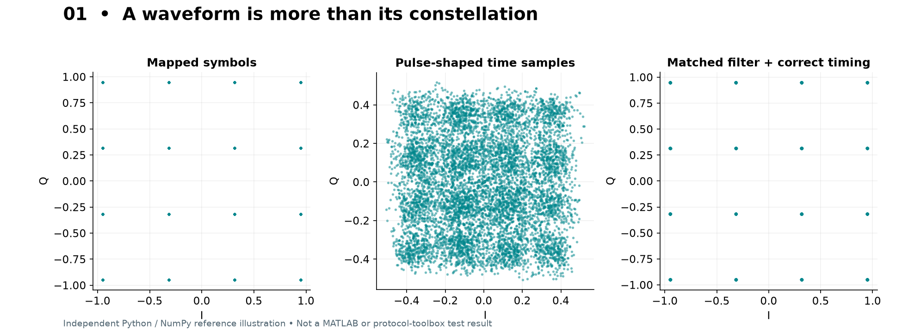
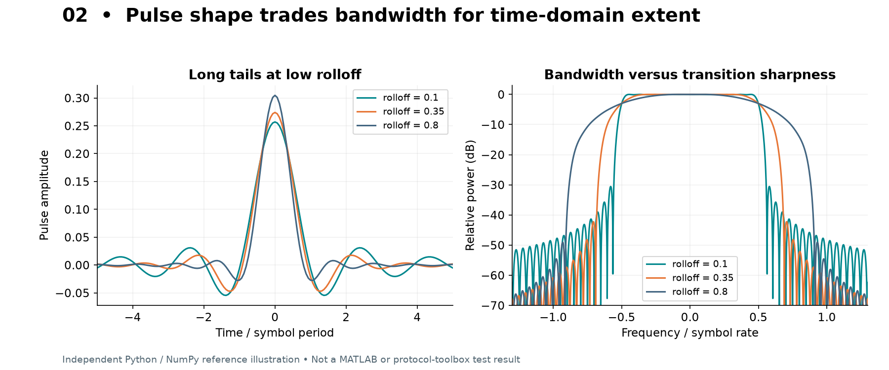

# 02 · 调制与脉冲成形

## 1. 从二维点到连续波形

调制映射首先得到一列复数符号 `a[k]`。随后用脉冲 `p(t)` 连接这些符号：

```text
x(t) = Σ a[k] p(t − kTs)
```

星座图中的点通常指 `a[k]`，而不是任意时刻的 `x(t)`。直接对所有过采样点画散点，会出现点之间的轨迹、圆环或云团；这不表示映射错误。先匹配滤波、补偿延迟、恢复定时，再谈接收星座。



## 2. PSK 与 QAM

| 调制 | 本项目映射特点 | 看什么 | 实验用途 |
|---|---|---|---|
| BPSK | 两点 ±1，1 bit/symbol | 相位相差 π | 噪声/BER 基准 |
| QPSK | 四点，I/Q 各一个符号位 | 每符号 2 bit | 比较频谱效率 |
| 8PSK | 8 个相位，Gray 标号 | 相位间距缩小 | 理解相位噪声敏感性 |
| 16QAM | 4×4 方格，4 bit/symbol | 幅度、相位同时变化 | EVM 与削顶 |
| 64QAM | 8×8 方格，6 bit/symbol | 点间距离更小 | 高阶调制对 SNR 的需求 |
| 256QAM | 16×16 方格，8 bit/symbol | 同平均能量下容错更小 | 仪器/链路线性度 |

Gray 标号使最近邻误判通常只改变一个比特。它不会扩大几何距离，也不能消灭噪声。

本项目 QAM 的归一化分母为 `sqrt(2*(M-1)/3)`，使完整等概率星座的平均能量为 1。有限随机符号块的实测平均能量会稍有偏离。基础映射的位序属于本项目约定；标准协议应调用对应标准映射器，不要把基础函数直接替换进去。

## 3. 为什么需要 RRC

直接用矩形脉冲重复符号很容易实现，但频谱旁瓣衰减慢。Raised Cosine（RC）总体响应满足 Nyquist 零 ISI 条件；发射和接收各用一个 Root Raised Cosine（RRC），组合后近似 RC。

关键参数：

- `Rolloff=α`：越小，频谱越紧，但时域尾巴越长，对截断/定时更敏感。
- `FilterSpanSymbols`：有限 FIR 覆盖的符号数；增大后更接近理想响应，同时增加计算与延迟。
- `SamplesPerSymbol`：每符号采样点；改变它不等于改变符号率。

理想 RC/RRC 的复数基带总支撑带宽约 `(1+α)Rs`；99% 功率带宽并不严格等于该数值。默认 Rs=1 MHz、α=0.35，理想支撑约 1.35 MHz。

长度为 `span*SPS+1` 的对称滤波器，单个群延迟为 `span*SPS/2` 样点。发射加接收合计 `span*SPS`。lab02 按这个延迟抽样。保留滤波尾巴是为了让包末符号也能恢复，不能简单删除看起来“不整齐”的点。



## 4. FSK、GFSK 与调制指数

FSK 把比特变成瞬时频率；相位是频率积分：

```text
x(t)=exp(jφ(t)),  φ(t)=2π∫ f_inst(τ)dτ
h = 2Δf/Rs
```

对二进制连续相位 FSK，未平滑的稳态偏移为 ±Δf。GFSK 先用高斯滤波器平滑频率控制序列，再积分成相位。BT 是高斯滤波器带宽与符号周期的乘积；它控制过渡平滑度，不是 Bluetooth 的缩写。

基础 `gfsk` 默认 h=0.5、Rb=1 MHz，稳态频偏约 ±250 kHz，包络为 1。改变 BT 会改变过渡速度和旁瓣；改变 h 会改变频率摆幅。这里的中心化有限高斯滤波实现用于观察机理，不替代标准蓝牙包发生器。

为什么恒包络有用：理想情况下可容忍更高效率的非线性功放。但实际包边缘、滤波、IQ 失配仍可能产生包络变化。

## 5. OQPSK 与半正弦成形

QPSK 的 I/Q 可以同时改变符号；OQPSK 把两支路错开半个支路符号周期，避免两支同时跨零造成的最大相位跳变。

在本项目教学 OQPSK 中：串行码片速率 Rc=2 Mchip/s，奇偶码片分别进入 I/Q；每支路更新率为 Rc/2，Q 相对 I 延迟一个串行码片周期 Tc。每个半正弦脉冲持续 2Tc。内部区间 I/Q 形如带正负号的 sin/cos，平方和为 1，因此包络近似恒定；首尾上升/下降段除外。

这解释了 Thread/802.15.4 的波形特性，却还缺少 IEEE 规定的 4-bit→32-chip 码表、前导和帧头。`oqpsk` 是教学信号；`thread` 预设才调用标准 PHY 生成器。

## 6. 差分相位调制与经典蓝牙

普通 PSK 的信息由绝对星座点决定；差分 PSK 由相邻符号的相位变化决定。经典蓝牙 EDR 载荷使用差分相位调制：EDR2M 使用 π/4-DQPSK，EDR3M 使用 8DPSK；包的其他部分仍有不同处理。不能把整包当作单一 QPSK 或 8PSK 信号。协议层的细节由 `bluetoothWaveformGenerator` 实现。[官方入口](https://www.mathworks.com/help/bluetooth/ref/bluetoothwaveformgenerator.html)

## 7. 扩频与 chirp

DSSS 是用更快的码片序列展开数据，接收端用已知序列相关恢复。理想处理增益常写为 `10 log10(Rchip/Rdata)`，但真实干扰抑制依赖同步、码相关、干扰类型和接收结构。

FHSS 是载频随时间切换；信道内可以仍采用 GFSK。跳频策略、驻留时间和网络时序也是协议的一部分，不能靠随机频移模拟出完整蓝牙跳频连接。

Chirp 是频率随时间扫动。线性 chirp 可由二次相位生成；LoRa 等系统还有专用符号、编码和包结构。lab13 的 chirp 只是扩展原理演示。

## 8. 现在应该能回答

1. 为什么 16QAM 的时域散点不只有 16 个点？
2. 为什么 GFSK 的相位连续，但瞬时频率会变化？
3. 为什么 RRC 滤波越长，第一次有效判决通常越晚？
4. 为什么 OQPSK 的码片采样率与支路符号采样率容易差一倍？

答案在 [术语与练习答案](11_glossary_answers.md)。
