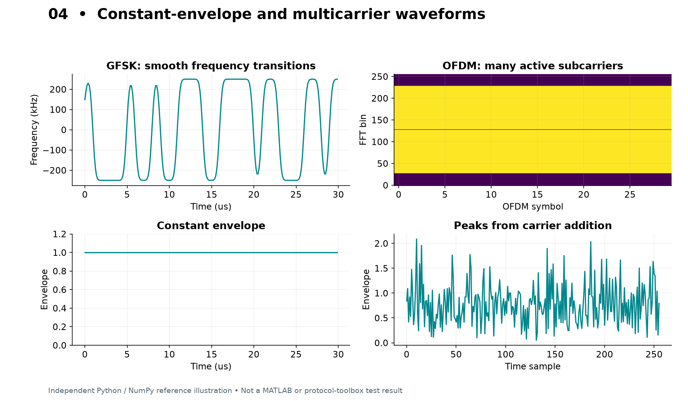

# 04 · Cellular、Wi-Fi、Bluetooth、Thread 的联系与区别

## 快速对照

| 家族 | 本项目 PHY | 波形组织 | 频域观察 | 本版帧/网络范围 |
|---|---|---|---|---|
| LTE DL | 标准参考测量信道 | OFDM | 连续资源占用、参考信号 | 参考帧，不提供接入网络 |
| LTE UL | 上行参考信道 | DFT-s-OFDM | 资源分配与较低包络起伏 | 无真实调度器 |
| NR DL | FR1 PDSCH+DM-RS | CP-OFDM | 可变 SCS/PRB | 默认关 SSB/PDCCH |
| NR UL | PUSCH+DM-RS | CP/DFT-s-OFDM | 可比较预编码前后 PAPR | 无随机接入 |
| Wi-Fi | non-HT/HT/VHT/HE/EHT | OFDM；HE MU 可 OFDMA | 突发包和前导 | 随机 PSDU，不含有效 MAC 会话 |
| BLE | 1M/2M/Coded PHY | GFSK | 窄带突发、平滑频率摆动 | 默认有效广播 PDU；其他模式为 PHY 测试 |
| 经典蓝牙 | BR/EDR | BR GFSK；EDR 差分 PSK 载荷 | 包内不同字段可不同形态 | 无跳频连接状态机 |
| Thread PHY | 2.4GHz 802.15.4 | DSSS+半正弦 OQPSK | 扩频与近恒包络 | 无 Thread/6LoWPAN/MLE/安全栈 |



## 1. 蜂窝：先明确下行还是上行

### LTE

`lte_dl` 调用 `lteRMCDLTool`；`lte_ul` 调用 `lteRMCULTool`。RMC（参考测量信道）给你一套彼此一致的资源配置，适合先观察标准波形，再逐项理解参数。下行默认 `R.0`，上行默认 `A1-3`。不要仅从 RC 名字猜带宽；查看 `w.details.LTEConfig` 中实际 RB 数、采样率与调制。

```matlab
p = sm.defaultConfig('lte_ul');
w = generate_waveform(p);
disp(w.details.LTEConfig)
imagesc(abs(w.details.ResourceGrid(:,:,1))); axis xy
```

要发送你自己的数据，可在 `generateLTE.m` 中把随机 `bits` 替换成二进制列向量；工具箱可能循环使用输入比特以填满多个传输块。因此应保存输入及每个块的实际配置，而不是假定“一次传入恰好一个包”。

### 5G NR

默认 NR 方案刻意把数据链路配置写明：单 BWP、单层、FR1、PDSCH 或 PUSCH、DM-RS、编码与目标码率。`w.details.NRConfig` 是可检查的工具箱配置对象，`WaveformInfo` 包含资源网格等信息。

SSB 用于同步/广播相关内容，PDCCH 承载控制；本项目默认下行关闭它们，适合调制、功放、频谱和资源格实验，不能使手机驻留在这个“基站”上。

想研究小区搜索和控制信道，应沿官方完整下行示例扩展，并同步设置 SSB pattern、SCS、CORESET、搜索空间、DCI 与 PDSCH 资源。不要只把 `SSBurst.Enable` 改成 true 就宣称做出了真实基站。

## 2. Wi-Fi：代际与配置对象

| 本项目名 | 配置对象 | 实验定位 |
|---|---|---|
| wifi_nonht | wlanNonHTConfig | OFDM 基线，适合首次接收恢复 |
| wifi_ht | wlanHTConfig | 802.11n，高吞吐 |
| wifi_vht | wlanVHTConfig | 802.11ac，VHT |
| wifi_he | wlanHESUConfig | 802.11ax，HE 单用户 |
| wifi_eht | wlanEHTMUConfig | 802.11be，配置为单用户 |

这些对象不代表完整家庭路由器。PHY 前导、信令和数据字段由 `wlanWaveformGenerator` 组织；输入 PSDU 是否含正确 MAC 头、地址、FCS、聚合子帧，由更上层的生成流程决定。本版默认使用随机 PSDU，适合 PHY 仪器实验。

对 non-HT/HT，载荷字段使用 PSDULength；VHT/HE/EHT 配置使用 APEP 长度，再由对象计算实际 PSDU 字节数。项目已经处理这一差别，避免高代际包尾填充使比特长度不匹配。

`MCS` 不是独立的 QAM 阶数选择器。合法组合还取决于带宽、空间流、编码、RU 等。开始时使用默认 MCS=0；逐步改 2、4、7；高阶 MCS 以对应版本 `doc` 表格为准。

本项目通用适配器只处理一个用户。HE OFDMA 使用 `lab15_wlan_ofdma`，通过每用户一个比特向量演示资源分配。VHT 两天线可以直接改 `NumTransmitAntennas=2`、`NumSpaceTimeStreams=2`。

参考：[WLAN 生成器](https://www.mathworks.com/help/wlan/ref/wlanwaveformgenerator.html)、[HE PSDU 长度](https://www.mathworks.com/help/wlan/ref/wlanhesuconfig.getpsdulength.html)、[EHT 用户设置](https://www.mathworks.com/help/wlan/ref/wlanehtuser.html)。

## 3. Bluetooth：LE 与 BR/EDR 分开理解

### BLE

LE1M 是 1 Msym/s GFSK，LE2M 是 2 Msym/s；LE500K 和 LE125K 通过编码扩展提高鲁棒性，其空中调制符号速率仍是 1 Msym/s。于是 SPS=8 时，采样率分别是 8、16、8、8 MS/s。

BLE 逻辑 ChannelIndex 不按 RF 频率顺序简单排列：广播信道 37/38/39 对应 2402/2426/2480 MHz。`sm.bleFrequency` 负责映射。ChannelIndex 也用于白化，不能只改仪器本振而不更新相关配置。

`PayloadKind='advertising'`：LE1M、广播信道，使用工具箱构建广播 PDU 与 CRC，广告内容是 Flags 和名称 SimLab01。该输入已经包括 CRC，禁止再重复添加。`lab08_ble_receive` 同时检查 PHY 比特恢复和 LL 解码。

`PayloadKind='phy-test'`：输入随机测试位，包括占据 PDU/CRC 位置的位；它们并不是有效 CRC。可研究四种 PHY，却不能用它验证手机扫描或连接行为。经典广播也不允许简单替换成 LE2M 发送；扩展广播需要对应结构和时序。

### 经典蓝牙

BR、EDR2M、EDR3M 的基础调制符号率均为 1 Msym/s；EDR 每符号传更多位。SPS=8 时三者都是 8 MS/s。模式切换还需合法 PacketType，项目默认使用 `DH1` 并交由配置对象验证。

随机信道跳转的 GFSK 片段并不等于真正连接中的跳频序列。包时序、地址、白化初始化和控制器状态都有关。本版侧重生成工具箱 PHY 包，不模拟 piconet。

参考：[BLE 生成器](https://www.mathworks.com/help/bluetooth/ref/blewaveformgenerator.html)、[BLE 官方入门](https://www.bluetooth.com/bluetooth-le-primer/)、[BR/EDR 配置](https://www.mathworks.com/help/bluetooth/ref/bluetoothwaveformconfig.html)。

## 4. Thread：物理层与网络层的分界

Thread 是基于 IPv6 的低功耗网状网络体系。常见 2.4 GHz Thread 无线链路使用 IEEE 802.15.4 PHY，并非一种名叫“Thread-QAM”的独立调制。它与 Zigbee 可共享相近物理层，却是不同网络协议；Matter 又是更上层应用体系。[OpenThread 官方说明](https://openthread.io/guides/thread-primer)

本项目固定 2.4 GHz OQPSK 路线：250 kbit/s → 每 4 bit 形成符号 → 标准扩频至 32 chip → 2 Mchip/s → 半正弦 OQPSK。标准扩频码表由工具箱实现。

帧由 4 字节前导、1 字节 SFD、1 字节 PHR 和 PSDU 组成。PSDU 包括 MAC 头、载荷与两字节 FCS，最大 127 字节。本项目 9 字节 MAC 头，因此应用测试载荷上限 116 字节。默认 32 字节测试载荷给出 43 字节 PSDU；不含成形尾部的名义时长为 `(6+43)*8/250000=1.568 ms`。

MAC 头采用短地址、PAN 压缩、无安全、无 ACK 请求；FCS 使用 CRC-16/KERMIT 形式（反射多项式 0x8408、初值 0）。这个结构可以用于 PHY/裸 MAC 实验，但测试载荷并非有效 Thread 网络报文。

信道频率：`fc_MHz=2405+5*(channel-11)`，信道 11–26。Channel=15 对应 2425 MHz。[OpenThread 无线常量](https://github.com/openthread/openthread/blob/main/include/openthread/platform/radio.h)

**采样参数注意：** `lrwpanOQPSKConfig.SamplesPerChip` 按工具箱的成形 chip pulse 约定定义，不要套用教学 `oqpsk` 的串行码片 SPS。代码读取 `cfg.SampleRate` 并用包时长复核；用户只需认准最终输出采样率。

## 5. 按实验选择实现层次

| 目标 | 选择 |
|---|---|
| 看 QAM 阶数、成形与噪声 | basic + lab02/03/06 |
| 测功放包络/频谱再生 | 完整协议 IQ，保留导出缩放与 PAPR |
| 测仪器 PHY 解调 | 先从默认合法预设及已知包长开始 |
| 测 MAC CRC | BLE 默认广播或 802.15.4 MAC 示例；Wi-Fi 需另外构造有效 MAC |
| 测真实设备接入/吞吐 | 加入协议栈、调度和合适射频硬件；超出本版离线波形范围 |
| 测共存干扰 | lab14，并明确相对功率、占空比、频偏与接收判据 |
