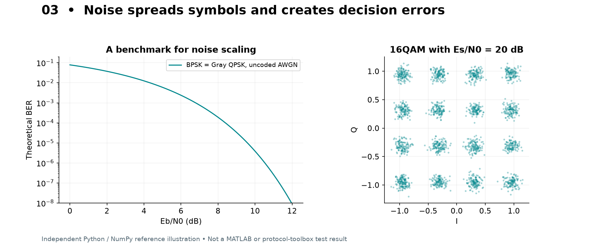

# 07 · 如何证明波形正确

## 1. 按层验证

| 层 | 应检查 | 不能据此证明 |
|---|---|---|
| 文件 | 字节数、IQ 顺序、端序、读回误差 | 协议正确 |
| 数值 | 非零、有限、采样率、长度 | MAC/CRC 有效 |
| 波形 | 时间包络、PSD、时频图、峰值 | 接收可解码 |
| PHY | 同步、解调、EVM、已知位比较 | 能加入真实网络 |
| MAC/链路 | CRC、地址、包类型、时序 | 网络认证与应用成功 |
| 系统 | 接入、吞吐、丢包、延迟 | 标准一致性认证 |

先做离线无噪声回环，再加噪声、信道和硬件。每加一项都保留一个干净对照。

## 2. PSD 的口径

`sm.psd` 使用周期 Hann 窗、50% 重叠、双边 Welch 平均，输出单位是数字幅度平方/Hz。积分 `sum(PSD)*df` 应近似记录平均功率。对平稳整周期单音，项目测试要求误差<1e-10。

全记录包含空闲时，PSD 的平均电平低于仅包内统计。若将每张图按各自最大值归一化，能比较形状，却不能比较绝对数字功率。测旁瓣和邻道时应使用同一采样率、窗、FFT 长度、参考电平与积分范围。

## 3. OBW99

项目从累计 PSD 的 0.5% 与 99.5% 位置估计占用带宽；这不是“超过某个阈值的谱宽”，也不是分配信道带宽。有限记录、包边缘、噪声和窗函数都会影响结果。

加上白噪声后，OBW99 可能大幅增长，因为噪声铺满采样带宽。不能把这个增长全归因于调制本身。仪器的 OBW 算法/扫宽/RBW 也可能不同。

## 4. PAPR 与占空比

`PAPR=10log10(max|x|²/mean|x|²)`。如果平均值包含包间空闲，PAPR 会比包内平均定义高。必须写明口径。

本项目 metrics 使用全记录、现有样点、每天线分别统计。要得到更接近连续时间的峰值，应提高过采样并验证插值滤波；这不是 simply 对曲线插更多显示点。比较不同协议时不能忘记其占空比不同。

## 5. EVM

`EVM_RMS=100*sqrt(Σ|s_rx−s_ref|² / Σ|s_ref|²)`。输入必须是匹配的参考符号和恢复符号，已经对齐时间、频率、资源位置。

`sm.evm(...,false)` 不拟合增益，保留幅度与相位偏差；`true` 只拟合一个复数标量。它不会进行包检测、定时恢复、CFO 估计或逐子载波均衡。使用不同补偿规则得到的 EVM 不能直接比较。

对 OFDM，请在 FFT、信道均衡、导频/CPE 处理之后对指定数据资源计算 EVM。任意时域样点散点绝不是 OFDM 的 QAM 星座。

## 6. AWGN、SNR、Es/N0、Eb/N0

若单位平均符号能量 Es=1，未编码每符号 k 位，则 `N0=1/(k*10^(EbN0dB/10))`；复噪声的实部/虚部方差各为 N0/2。lab03 按此构造符号域噪声。

过采样波形若滤波器归一化为单位能量，平均样点功率约为 Es/SPS；固定 Es/N0 下的样点 SNR 与符号 SNR 相差 `10log10(SPS)`。但实际换算还要考虑码率、导频、CP、空闲和滤波约定。不要把 symbol-domain 公式原样套到所有波形。

sm.impair 明确使用**信道处理后全记录平均样点功率**作为 SNR 分母基准。它不是按每个比特能量定义的噪声工具。

## 7. BER/PER 的统计可信度

低误码区需要更多样本。如果 N 位没有错误，常用近似 95% 置信上界是 3/N。1000 位全对只说明 BER 大致小于 0.003 的量级，不能证明 10^-6。

建议在每个 SNR 点积累足够错误数（例如至少 100），或达到预定最大样本数后报告统计上界。包检测失败必须计入 PER，不能只对“成功同步的好包”统计。

## 8. 频偏与 IQ 失衡

恒包络信号可用相邻样点共轭积估计瞬时频率：`angle(x[n]conj(x[n−1]))Fs/(2π)`。接近零幅度处相位不可靠，绘图会屏蔽小幅度区。OFDM 的瞬时相位频率并不直接等于某个子载波频率。

IQ 增益/相位失衡常导致镜像。用单音作测试更容易量化镜像抑制；用随机宽带调制时，原谱和镜像可能重叠。lab06 是机理模型，不代替硬件校准程序。

## 9. 仪器上要额外核对

- 采样时钟偏差会引起随时间累积的定时误差，区别于本振 CFO。
- 包长、触发、循环边界与空闲会影响捕获是否完整。
- 信号源、线缆、衰减器、接收机都可能引入频响与压缩。
- 自动增益、自动归一化、自动中心频率估计会掩盖你故意设置的失真，应记录其开关状态。
- 认证测试的限值、测量带宽、参考信号和补偿步骤应按对应标准执行；本项目测量函数用于教学和预检。
